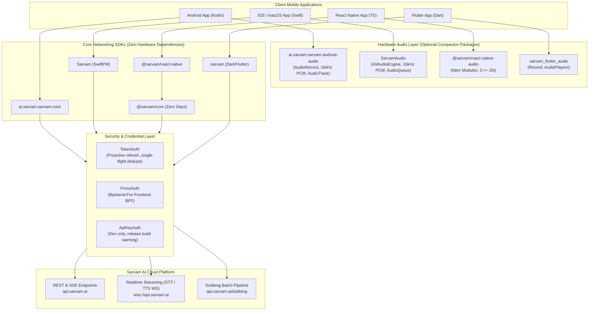

# Sarvam AI Mobile SDKs

[](https://github.com/sarvamai/sarvam-mobile/actions/workflows/ci.yml)
[](https://opensource.org/licenses/MIT)
[](https://github.com/googleapis/release-please)

## 📌 About

**Sarvam Mobile** provides the official, production-ready mobile client SDKs for [Sarvam AI](https://sarvam.ai)'s Indic-first speech, translation, and language APIs[cite: 1]. 

Designed from the ground up to support modern mobile client architectures across **Android (Kotlin)**, **iOS (Swift)**, **React Native**, and **Flutter (Dart)**, the monorepo separates core network communication from platform hardware[cite: 1]:

- **Decoupled Architecture**: Core client packages contain zero hardware or OS audio framework dependencies, making them lightweight, headless, and strictly cross-platform[cite: 1].
- **Companion Audio Engines**: Dedicated companion packages handle low-latency hardware audio capture, 16 kHz PCM conversion, and streaming playback per platform[cite: 1].
- **Mobile-First Security**: Built-in credential layers featuring `TokenAuth` (single-flight request coalescing, proactive refresh) and `ProxyAuth` to keep production API keys off the client binary[cite: 1].
- **Indic Language Pipeline**: First-class streaming and REST interfaces for translation, speech-to-text, text-to-speech, and dubbing pipelines across 11+ Indian languages[cite: 1].

---

## 🏛️ Architecture Overview

The Sarvam Mobile monorepo adheres strictly to **Clean Architecture**, **SOLID principles**, and **Separation of Concerns**. Core networking packages manage stateless API interactions, WebSocket streaming, resilient exponential backoff, and authentication token lifecycles with **zero hardware or audio framework dependencies**. Companion audio packages provide optional, platform-native microphone sampling, 16 kHz PCM conversion, and low-latency audio playback.



---

## 📦 Monorepo Packages

| Platform / Ecosystem | Package Identifier | Directory | Description |
| :--- | :--- | :--- | :--- |
| **Android / Kotlin** | `ai.sarvam:sarvam-core` | [`packages/kotlin/sarvam-core`](packages/kotlin/sarvam-core) | Core Android/JVM client (Ktor/OkHttp, Coroutines, Serialization) |
| **Android / Kotlin** | `ai.sarvam:sarvam-android-audio` | [`packages/kotlin/sarvam-android-audio`](packages/kotlin/sarvam-android-audio) | Microphone capture, 16 kHz PCM resampling, audio player |
| **iOS / Swift** | `Sarvam` | [`packages/swift/Sources/Sarvam`](packages/swift/Sources/Sarvam) | Core Swift Package (Swift 6 concurrency, URLSession, SSE) |
| **iOS / Swift** | `SarvamAudio` | [`packages/swift/Sources/SarvamAudio`](packages/swift/Sources/SarvamAudio) | AVAudioEngine streaming capture, 16 kHz resampling, playback |
| **TypeScript / Web** | `@sarvam/core` | [`packages/ts-core`](packages/ts-core) | Isomorphic zero-dependency TypeScript SDK (Fetch, WS, AsyncIterable) |
| **React Native** | `@sarvam/react-native` | [`packages/react-native`](packages/react-native) | React Native bindings with native WebSocket optimization |
| **Flutter / Dart** | `sarvam` | [`packages/dart/sarvam`](packages/dart/sarvam) | Core Dart client (Sound Null Safety, Streams, http) |
| **Flutter / Dart** | `sarvam_flutter_audio` | [`packages/dart/sarvam_flutter_audio`](packages/dart/sarvam_flutter_audio) | Flutter audio capture and audio player companion |

---

## 🔒 Security & Mobile Authentication Model

> [!WARNING]
> **Never compile static API subscription keys into mobile application binaries!**  
> Strings embedded in `.apk`, `.aab`, or `.ipa` bundles are trivially extracted using decompilers (`apktool`, `strings`, `class-dump`).

Every Sarvam mobile SDK implements the canonical `AuthProvider` contract with three distinct strategies:

1. **`TokenAuth(tokenFetcher)` (Recommended for Native Mobile)**:
   - Fetches a short-lived bearer token from your application's secure auth server.
   - Proactively refreshes the token in the background **60 seconds prior to expiration**.
   - Applies **single-flight request coalescing** so that multiple concurrent network requests await the same refresh task without triggering redundant auth roundtrips.
   - Automatically handles `401 Unauthorized` and `invalid_api_key_error` by invalidating cache and retrying exactly once.
2. **`ProxyAuth(proxyBaseUrl, headersProvider)` (Backend-For-Frontend BFF)**:
   - Routes all client requests through your application's secure proxy backend (`SarvamEnvironment.proxy(...)`).
   - Keeps Sarvam API credentials strictly server-side.
3. **`ApiKeyAuth(apiKey)` (Prototyping & CI Only)**:
   - For rapid prototyping, unit testing, and server environments.
   - Automatically emits a visible `WARN` log in mobile release configurations.

### Apple Privacy Manifests
Both `Sarvam` and `SarvamAudio` include bundled Apple Privacy Manifests (`PrivacyInfo.xcprivacy`):
- **Tracking**: Set to `false` (zero tracking across third-party apps or websites).
- **Domains**: Empty tracking domain list.
- **Audio Usage**: Explicitly declared for app functionality without linking to user identities.

---

## 🚀 Quickstarts

### 1. Android (Kotlin)
```kotlin
// build.gradle.kts
dependencies {
    implementation("ai.sarvam:sarvam-core:0.1.0")
    implementation("ai.sarvam:sarvam-android-audio:0.1.0") // Optional
}

// Instantiate client with TokenAuth
val client = SarvamClient(
    config = SarvamClientConfig(
        authProvider = TokenAuth { myAuthRepository.fetchSarvamToken() }
    )
)

// Translate text
val translation = client.text.translate(
    TranslateRequest(
        inputText = "Where is the nearest railway station?",
        sourceLanguageCode = LanguageCode.EN_IN,
        targetLanguageCode = LanguageCode.HI_IN
    )
)
println(translation.translatedText)
```

### 2. iOS (Swift)
```swift
// Package.swift
dependencies: [
    .package(url: "https://github.com/sarvamai/sarvam-mobile.git", from: "0.1.0")
]

import Sarvam

let client = SarvamClient(
    config: SarvamClientConfig(
        authProvider: TokenAuth { try await authService.getSarvamToken() }
    )
)

let result = try await client.text.translate(
    TranslateRequest(
        inputText: "Good morning, how are you?",
        sourceLanguageCode: .enIN,
        targetLanguageCode: .bnIN
    )
)
print(result.translatedText)
```

### 3. React Native (TypeScript)
```bash
npm install @sarvam/react-native @sarvam/core
```
```typescript
import { SarvamClient, TokenAuth } from '@sarvam/react-native';

const client = new SarvamClient({
  authProvider: new TokenAuth(async () => {
    const res = await fetch('https://api.mycompany.com/auth/sarvam-token');
    return res.json();
  })
});

const response = await client.text.translate({
  input: "Welcome to India",
  sourceLanguageCode: "en-IN",
  targetLanguageCode: "te-IN"
});
console.log(response.translatedText);
```

### 4. Flutter (Dart)
```yaml
# pubspec.yaml
dependencies:
  sarvam: ^0.1.0
  sarvam_flutter_audio: ^0.1.0 # Optional
```
```dart
import 'package:sarvam/sarvam.dart';

final client = SarvamClient(
  config: SarvamClientConfig(
    authProvider: TokenAuth(tokenProvider: () => authRepo.getSarvamToken()),
  ),
);

final result = await client.text.translate(
  TranslateRequest(
    inputText: 'Thank you for your assistance',
    sourceLanguageCode: LanguageCode.enIN,
    targetLanguageCode: LanguageCode.mrIN,
  ),
);
print(result.translatedText);
```

---

## 🛠️ Local Development & Monorepo Workflow

### Prerequisites
- **Node.js**: `v20.0.0+`
- **Java Development Kit**: JDK 21+
- **Xcode**: 16.0+ (Swift 6.0 toolchain)
- **Dart SDK**: `^3.4.0` / Flutter `3.24.x+`

### Common Commands

```bash
# Verify Swift packages and run test suite
swift test

# Build and typecheck TypeScript core & React Native
npm --prefix packages/ts-core install && npm --prefix packages/ts-core run build
npm --prefix packages/react-native install && npm --prefix packages/react-native run build

# Analyze and test Dart package
cd packages/dart/sarvam && dart pub get && dart analyze

# Start the local conformance mock server
npm --prefix conformance/mock-server install
npm --prefix conformance/mock-server start
```

---

## 📄 License

This monorepo is licensed under the [MIT License](LICENSE).
Copyright © 2026 Sarvam AI and contributors.
