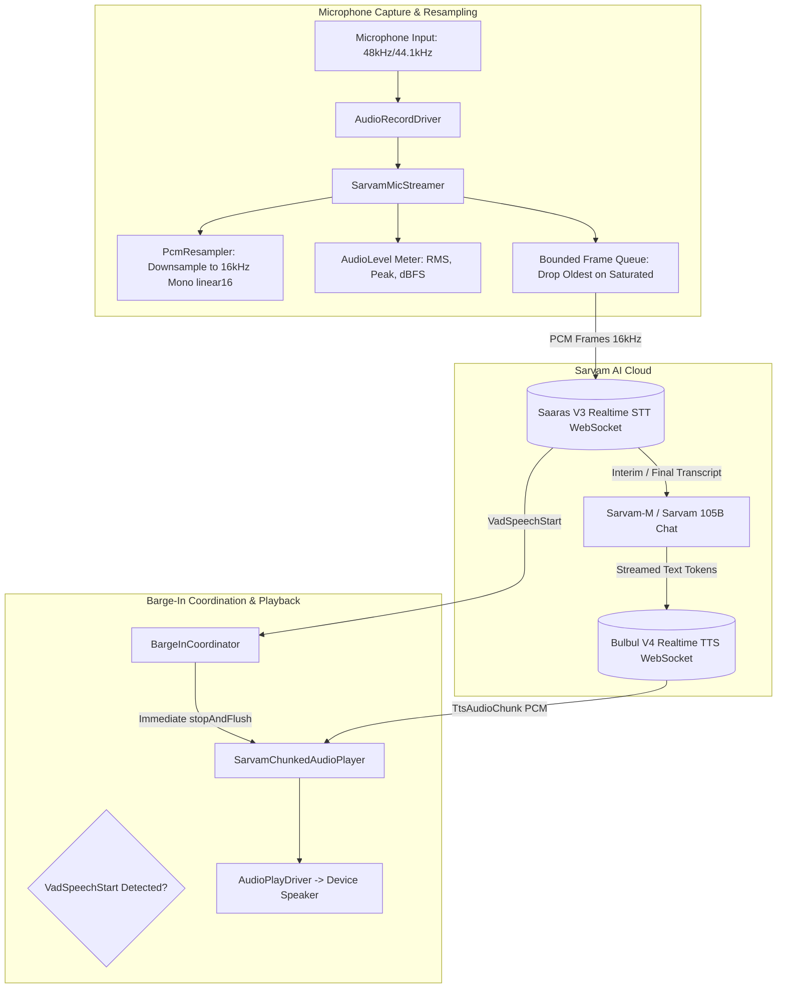

<p align="center">
  <a href="https://sarvam.ai">
    
  </a>
</p>

# sarvam_flutter_audio

[](https://pub.dev/packages/sarvam_flutter_audio)
[](https://opensource.org/licenses/MIT)
[](../../rust-core)
[](https://flutter.dev)

The unofficial Flutter and Dart companion audio package for [Sarvam AI](https://sarvam.ai).

Building real-time conversational voice assistants on mobile requires low-latency audio capture, strict audio format compliance, and instantaneous interruption (barge-in). `sarvam_flutter_audio` provides a production-grade audio pipeline engineered specifically for Sarvam's speech services:

- **Dual-Engine Resampling**: High-performance pure Dart downsampler combined with native FFI hardware acceleration via [`sarvam-rust-core`](../../rust-core) that converts incoming microphone audio (48 kHz, 44.1 kHz, mono/stereo, Int16 or Float32) into Sarvam's required **16 kHz mono `linear16` little-endian** format.
- **Bounded Backpressure Streamer**: Captures audio continuously and buffers frames in a bounded queue, safely dropping the oldest frames when network congestion occurs to prevent latency drift.
- **Sub-20ms Conversational Barge-In**: The `BargeInCoordinator` listens for server-side Voice Activity Detection (`VadSpeechStart`) and instantly halts playback and flushes hardware buffers when the user starts speaking.
- **Chunked Gapless Playback**: Plays streaming audio chunks from `client.textToSpeech.connect` and `client.textToSpeech.stream` as they arrive.
- **Pluggable Hardware Abstraction**: Clean driver interfaces (`AudioRecordDriver`, `AudioPlayDriver`) that easily adapt to any native plugin (`record`, `flutter_sound`, `audioplayers`, `just_audio`), with pre-built in-memory mock drivers for deterministic unit testing.

---

## Architecture: Real-time Conversational Duplex Pipeline



---

## Installation

Add `sarvam` and `sarvam_flutter_audio` to your `pubspec.yaml`:

```yaml
dependencies:
  sarvam: ^0.4.0
  sarvam_flutter_audio: ^0.3.0
```

---

## Quickstart: Conversational Voice Assistant with Barge-In

```dart
import 'package:flutter/foundation.dart';
import 'package:sarvam/sarvam.dart';
import 'package:sarvam_flutter_audio/sarvam_flutter_audio.dart';

void main() async {
  // 1. Initialize Sarvam client (use TokenAuth or Proxy in mobile production)
  final client = SarvamClient.withApiKey('YOUR_SARVAM_API_KEY');

  // 2. Setup your hardware drivers (or use Memory drivers for testing)
  final recordDriver = MemoryAudioRecordDriver(sampleRate: 48000, channelCount: 1);
  final playDriver = MemoryAudioPlayDriver();

  // 3. Create the chunked audio player
  final player = SarvamChunkedAudioPlayer(driver: playDriver);

  // 4. Connect to Sarvam's Realtime STT WebSocket
  final sttSession = await client.speechToText.connect(
    const SttRealtimeConfig(
      languageCode: LanguageCode.hiIn,
      model: SttModel.saarasV3Realtime,
      sampleRate: 16000,
      endpointing: true,
    ),
  );

  // 5. Setup Barge-In Coordinator
  // When user begins speaking, ongoing TTS audio is immediately cut off and flushed.
  final coordinator = BargeInCoordinator(
    session: sttSession,
    player: player,
    onBargeIn: (event) {
      if (kDebugMode) {
        print('⚡ Barge-in triggered! Audio player interrupted in < 20ms');
      }
    },
  )..start();

  // 6. Setup Microphone Streamer with real-time level metering
  final streamer = SarvamMicStreamer(
    driver: recordDriver,
    session: sttSession,
    maxQueueSize: 10,
    onAudioLevel: (level) {
      // Update UI volume meter
      // level.rms (0.0 to 1.0), level.peak, level.dbFs (-100 to 0 dBFS)
    },
    onDroppedFrame: (droppedCount) {
      if (kDebugMode) {
        print('Network backpressure: dropped $droppedCount stale audio frame(s)');
      }
    },
  );

  // 7. Start listening to user speech
  await streamer.start();

  // 8. Handle transcription events
  sttSession.events.listen((event) async {
    if (event is FinalTranscript) {
      if (kDebugMode) {
        print('User said: ${event.transcript}');
      }

      // Generate spoken reply via streaming TTS
      final ttsSession = await client.textToSpeech.connect(
        const TtsStreamingConfig(
          languageCode: LanguageCode.hiIn,
          speaker: Speaker.anushka,
          model: TtsModel.bulbulV4Flash,
        ),
      );

      // Attach player to stream audio chunks as they arrive
      player.attachSession(ttsSession);

      // Send response text
      ttsSession.sendText('नमस्ते! मैं आपकी किस प्रकार सहायता कर सकता हूँ?');
      ttsSession.flush();
    }
  });
}
```

---

## Core Components

### 1. `PcmResampler`

A pure Dart resampling engine with zero native dependencies:
- Converts little-endian signed 16-bit PCM bytes (`resamplePcm16`) or normalized 32-bit floats (`resampleFloat32`).
- Supports 48 kHz, 44.1 kHz, or any source sample rate down to 16 kHz.
- Supports mono and stereo (automatic downmixing).
- Computes comprehensive audio levels (`calculateLevels`) returning RMS amplitude, peak amplitude, and dBFS values.

```dart
// Resample 48 kHz mono to 16 kHz mono
final Uint8List resampledBytes = PcmResampler.resamplePcm16(
  raw48kBytes,
  inputSampleRate: 48000,
  channelCount: 1,
);

// Calculate volume levels for UI visualization
final AudioLevel level = PcmResampler.calculateLevels(resampledBytes);
print('RMS: ${level.rms}, Peak: ${level.peak}, dBFS: ${level.dbFs}');
```

### 2. `SarvamMicStreamer`

Buffers and pipelines resampled audio into an active `SttRealtimeSession`:
- `maxQueueSize`: Prevents buffer bloat when cellular network latency spikes by dropping the oldest unconsumed frames.
- `setPaused(bool)`: Seamlessly pause/resume audio streaming without disconnecting the WebSocket session.
- `onAudioLevel`: Emits volume updates for animating microphone wave forms.

### 3. `SarvamChunkedAudioPlayer`

Plays incoming audio chunks with minimal latency:
- `playChunk(Uint8List)`: Plays a single PCM chunk.
- `playStream(Stream<Uint8List>)`: Plays a chunked audio stream.
- `attachSession(TtsStreamingSession)`: Listens to a WebSocket TTS session and plays `TtsAudioChunk`s immediately.
- `stopAndFlush()`: Immediately stops playback, cancels active subscriptions, and flushes hardware audio buffers.

### 4. `BargeInCoordinator`

Coordinates interruption between user input and assistant output:
- Subscribes to `SttRealtimeSession.events`.
- When `VadSpeechStart` is detected, calls `SarvamChunkedAudioPlayer.stopAndFlush()`.
- Triggers the optional `onBargeIn` callback so your UI can update its state to "User Speaking".

---

## Pluggable Hardware Drivers

`sarvam_flutter_audio` decouples audio logic from platform hardware through two clean interfaces:

```dart
abstract class AudioRecordDriver {
  int get sampleRate;
  int get channelCount;
  bool get isRecording;
  FutureOr<void> startRecording(void Function(Uint8List pcmChunk) onAudioData);
  FutureOr<void> stopRecording();
}

abstract class AudioPlayDriver {
  bool get isPlaying;
  FutureOr<void> playChunk(Uint8List pcmBytes);
  FutureOr<void> flush();
  FutureOr<void> stop();
}
```

### Unit Testing Without Hardware

Use the included in-memory drivers to test your voice logic deterministically in CI:

```dart
final recordDriver = MemoryAudioRecordDriver(
  chunks: [testChunk1, testChunk2],
  sampleRate: 48000,
);
final playDriver = MemoryAudioPlayDriver();

final streamer = SarvamMicStreamer(driver: recordDriver);
final player = SarvamChunkedAudioPlayer(driver: playDriver);

await streamer.start();
// Verify played chunks in tests:
expect(playDriver.playedChunks, isNotEmpty);
```

---

## License

This package is distributed under the [MIT License](LICENSE).
