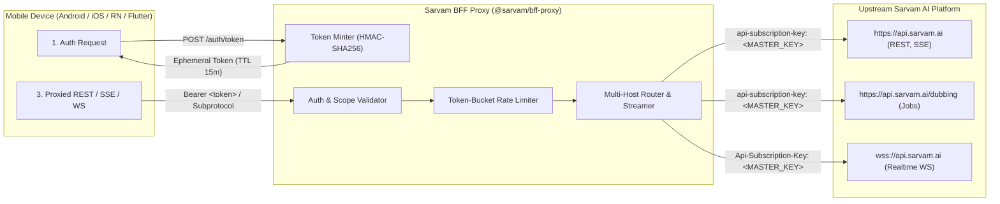

# @sarvam/bff-proxy

> **Production-Grade Reference Backend-For-Frontend (BFF) & Ephemeral Token Proxy for Sarvam AI Mobile SDKs**

[](https://nodejs.org/)
[](https://workers.cloudflare.com/)
[](LICENSE)

---

## 1. Overview & Security Architecture

Mobile applications (Android, iOS, Flutter, React Native) must **never** bundle static master API keys. Hardcoded keys in client application binaries can be decompiled and extracted via `strings`, `apktool`, or class-dumping tools.

`@sarvam/bff-proxy` is a zero-bloat, production-ready reference proxy providing:
- **Master Key Isolation**: Secret upstream `api-subscription-key` resides strictly on the server and is never sent to or visible from mobile clients.
- **HMAC-SHA256 Ephemeral Tokens**: Stateless, short-lived tokens minted with configurable TTL (default 15 minutes), client subjects (`sub`), and granular feature scopes (`stt`, `tts`, `text`, `chat`, `doc_ai`, `dubbing`).
- **Dual-Runtime Support**:
  - **Cloudflare Workers / WinterCG Edge** (`src/worker.ts`): Built exclusively on standard Web APIs (`Request`, `Response`, `fetch`, `crypto.subtle`, `WebSocketPair`) with **zero** external dependencies.
  - **Node.js 20+ Server** (`src/node-server.ts`): Standalone HTTP + WebSocket proxy server using native `http` and lightweight `ws`.
- **Zero-Buffering Streaming**: Real-time pass-through for SSE (`text/event-stream`, e.g., `/v2/chat/completions`) and chunked audio (`application/octet-stream`), injecting `Cache-Control: no-cache` and `X-Accel-Buffering: no`.
- **Bidirectional WebSocket Upgrades**: Native proxying for real-time speech channels (`/speech-to-text-realtime/ws`, `/text-to-speech/ws`, `/voices/clone/ws`) authenticating via `bearer.<token>` or `api-subscription-key.<token>` subprotocols.
- **Sliding-Window Rate Limiting**: Per-client token-bucket rate limiting returning HTTP `429` with `retry-after-ms` and canonical Sarvam error envelopes.
- **Multi-Host Routing**: Automatically routes `/dubbing/*` to `upstreamDubbingBaseUrl` and all other endpoints to `upstreamApiBaseUrl`.



---

## 2. Ephemeral Token Minting & Verification

### Minting an Ephemeral Token (`POST /auth/token`)

Your mobile app or user authentication flow requests a short-lived token:

```http
POST /auth/token HTTP/1.1
Host: proxy.yourdomain.com
Content-Type: application/json

{
  "sub": "user_usr_98a72b",
  "scopes": ["stt", "tts", "text", "chat"],
  "ttlSeconds": 900
}
```

**Response (HTTP 200):**
```json
{
  "token": "eyJhbGciOiJIUzI1NiIsInR5cCI6IkpXVCJ9.eyJzdWIiOiJ1c2VyX3Vzcl85OGE3MmIiLCJpYXQiOjE3Mjk...3f4",
  "expiresAtEpochMs": 1729068900000
}
```

### Supported Scopes

| Scope | Allowed Endpoint Paths |
| :--- | :--- |
| `stt` | `/speech-to-text*`, `/speech-to-text-realtime/ws*` |
| `tts` | `/text-to-speech*`, `/text-to-speech/ws*`, `/voices*` |
| `text` | `/translate*`, `/transliterate*`, `/text-lid*` |
| `chat` | `/v1/chat*`, `/v2/chat*`, `/v2/responses*`, `/models*` |
| `doc_ai` | `/doc-ai*` |
| `dubbing` | `/dubbing*` |
| `*` or `all` | Unrestricted access to all endpoints |

---

## 3. Deployment Guides

### Option A: Cloudflare Workers (Serverless Edge)

Cloudflare Workers deploys globally across 300+ edge locations with zero cold start.

1. **Install Wrangler CLI:**
   ```bash
   npm install -g wrangler
   ```

2. **Configure `wrangler.toml`:**
   ```toml
   name = "sarvam-bff-proxy"
   main = "dist/src/worker.js"
   compatibility_date = "2024-09-23"
   compatibility_flags = ["nodejs_compat"]

   [vars]
   UPSTREAM_API_BASE_URL = "https://api.sarvam.ai"
   UPSTREAM_DUBBING_BASE_URL = "https://api.sarvam.ai/dubbing"
   UPSTREAM_WS_BASE_URL = "wss://api.sarvam.ai"
   RATE_LIMIT_RPM = "120"
   TOKEN_TTL_SECONDS = "900"
   ```

3. **Set Secrets (Encrypted at rest):**
   ```bash
   npx wrangler secret put SARVAM_API_KEY
   # Enter your upstream Sarvam API Subscription Key

   npx wrangler secret put BFF_TOKEN_SECRET
   # Enter a 32+ character random secret string for HMAC-SHA256 signing
   ```

4. **Build and Deploy:**
   ```bash
   npm run build
   npx wrangler deploy
   ```

---

### Option B: Node.js Server & Docker

For Kubernetes, AWS ECS, Fly.io, Railway, GCP Cloud Run, or custom VMs.

1. **Environment Variables:**
   ```bash
   export PORT=3000
   export SARVAM_API_KEY="your-upstream-sarvam-key"
   export BFF_TOKEN_SECRET="a-secure-random-secret-at-least-32-chars-long"
   export RATE_LIMIT_RPM=120
   ```

2. **Run with Node.js directly:**
   ```bash
   npm run build
   npm start
   ```

3. **`Dockerfile` example:**
   ```dockerfile
   FROM node:22-alpine AS builder
   WORKDIR /app
   COPY package*.json tsconfig.json ./
   RUN npm ci
   COPY src ./src
   RUN npm run build

   FROM node:22-alpine AS runner
   WORKDIR /app
   ENV NODE_ENV=production
   COPY package*.json ./
   RUN npm ci --omit=dev
   COPY --from=builder /app/dist ./dist
   EXPOSE 3000
   USER node
   CMD ["node", "dist/src/cli.js"]
   ```

4. **`docker-compose.yml` example:**
   ```yaml
   services:
     sarvam-proxy:
       build: .
       ports:
         - "3000:3000"
       environment:
         - PORT=3000
         - SARVAM_API_KEY=${SARVAM_API_KEY}
         - BFF_TOKEN_SECRET=${BFF_TOKEN_SECRET}
         - RATE_LIMIT_RPM=120
       restart: unless-stopped
   ```

---

## 4. Mobile SDK Integration Patterns

Mobile apps integrate with Sarvam SDKs using either **`TokenAuth`** or **`ProxyAuth`**.

### Pattern 1: `TokenAuth` (Recommended)

The mobile client fetches an ephemeral token from your backend upon session start and automatically refreshes it 60 seconds before expiration.

#### Android (Kotlin)
```kotlin
import ai.sarvam.SarvamClient
import ai.sarvam.auth.AuthProvider
import ai.sarvam.auth.SarvamCredentials
import ai.sarvam.auth.TokenAuth

val client = SarvamClient.Builder()
    .auth(TokenAuth {
        val res = myBackendApi.getEphemeralToken() // calls POST /auth/token
        SarvamCredentials.BearerToken(
            token = res.token,
            expiresAtEpochMs = res.expiresAtEpochMs
        )
    })
    .build()
```

#### iOS (Swift)
```swift
import Sarvam

let client = SarvamClient(
    configuration: .init(
        auth: .token {
            let res = try await myBackendApi.getEphemeralToken()
            return SarvamCredentials.bearerToken(
                token: res.token,
                expiresAtEpochMs: res.expiresAtEpochMs
            )
        }
    )
)
```

#### React Native / TypeScript
```typescript
import { SarvamClient, tokenAuth } from '@sarvam/core';

const client = new SarvamClient({
  auth: tokenAuth(async () => {
    const res = await myBackendApi.getEphemeralToken();
    return {
      token: res.token,
      expiresAtEpochMs: res.expiresAtEpochMs,
    };
  }),
});
```

#### Flutter (Dart)
```dart
import 'package:sarvam/sarvam.dart';

final client = SarvamClient(
  auth: TokenAuth(() async {
    final res = await myBackendApi.getEphemeralToken();
    return SarvamCredentials.bearerToken(
      res.token,
      expiresAtEpochMs: res.expiresAtEpochMs,
    );
  }),
);
```

---

### Pattern 2: `ProxyAuth` (Full BFF Route)

Directs all mobile traffic through your BFF proxy base URL, attaching your app's existing user session headers.

#### Android (Kotlin)
```kotlin
val client = SarvamClient.Builder()
    .environment(SarvamEnvironment.proxy("https://proxy.myapp.com"))
    .auth(ProxyAuth {
        mapOf("Authorization" to "Bearer ${userSession.token}")
    })
    .build()
```

#### iOS (Swift)
```swift
let client = SarvamClient(
    configuration: .init(
        environment: .proxy("https://proxy.myapp.com"),
        auth: .proxy {
            ["Authorization": "Bearer \(userSession.token)"]
        }
    )
)
```

#### React Native / TypeScript
```typescript
import { SarvamClient, SarvamEnvironment, proxyAuth } from '@sarvam/core';

const client = new SarvamClient({
  environment: SarvamEnvironment.proxy('https://proxy.myapp.com'),
  auth: proxyAuth(async () => ({
    'Authorization': `Bearer ${userSession.token}`,
  })),
});
```

#### Flutter (Dart)
```dart
final client = SarvamClient(
  environment: SarvamEnvironment.proxy('https://proxy.myapp.com'),
  auth: ProxyAuth(() async => {
    'Authorization': 'Bearer ${userSession.token}',
  }),
);
```

---

## 5. Canonical Error Envelope Specification

All authentication and rate limiting errors produced by the proxy match Sarvam's canonical error schema:

### Invalid / Expired / Tampered Token (`HTTP 403`)
```json
{
  "error": {
    "code": "invalid_api_key_error",
    "message": "Token expired at 2026-10-16T10:00:00.000Z",
    "request_id": "req_m8q9a1_7b8c"
  }
}
```

### Rate Limit Exceeded (`HTTP 429`)
```http
HTTP/1.1 429 Too Many Requests
Content-Type: application/json
retry-after-ms: 12500
Retry-After: 13
x-request-id: req_m8q9a2_9e2f

{
  "error": {
    "code": "rate_limit_exceeded_error",
    "message": "Rate limit exceeded. Please retry after 13s.",
    "request_id": "req_m8q9a2_9e2f"
  }
}
```

---

## 6. Testing & Conformance

The package includes an end-to-end conformance test suite (`test/proxy.test.ts`) that runs with Node.js built-in test runner (`node:test`):

```bash
cd proxy
npm install
npm test
```

### Verification Checklist:
- [x] **Stateless Ephemeral Token Minting**: `POST /auth/token` issues signed HMAC-SHA256 tokens.
- [x] **Canonical Error Envelopes**: Expired, tampered, or missing tokens return HTTP 403 `invalid_api_key_error`.
- [x] **Scope Enforcement**: Enforces path-level permissions based on token scopes.
- [x] **Key Isolation**: Injects upstream `api-subscription-key` while stripping client credentials and never leaking keys.
- [x] **Multi-Host Routing**: Routes `/dubbing/*` to `upstreamDubbingBaseUrl` and other endpoints to `upstreamApiBaseUrl`.
- [x] **Real-Time Streaming**: Zero-buffering pass-through for SSE (`/v2/chat/completions`) and chunked audio.
- [x] **Bidirectional WebSocket Proxy**: Connects to `upstreamWsBaseUrl` with subprotocol extraction (`bearer.<token>`).
- [x] **Sliding-Window Rate Limiting**: Emits HTTP 429 with `retry-after-ms` and `rate_limit_exceeded_error`.
